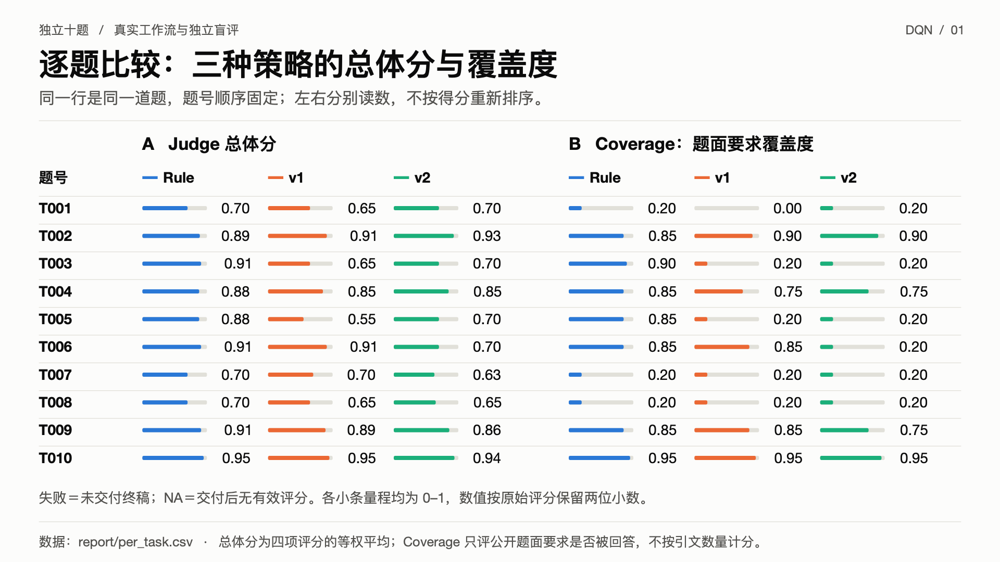
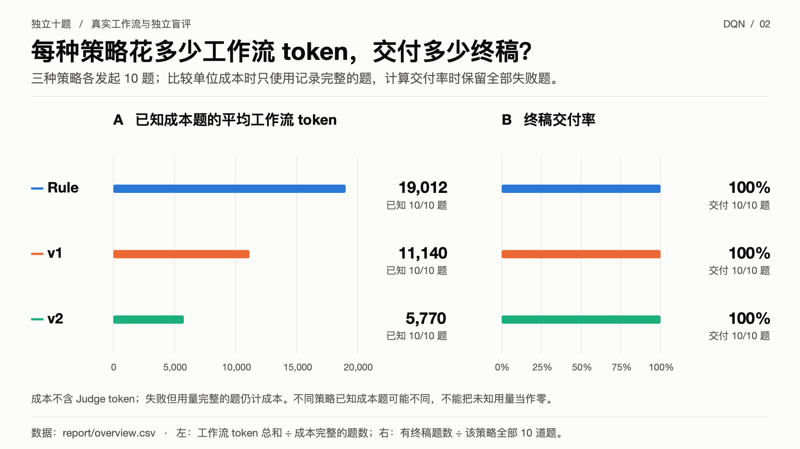
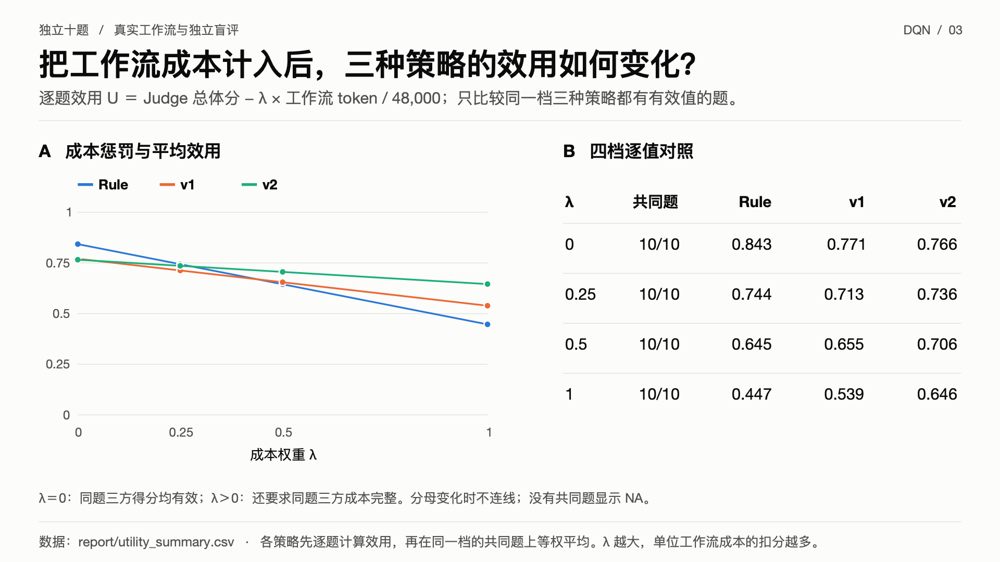
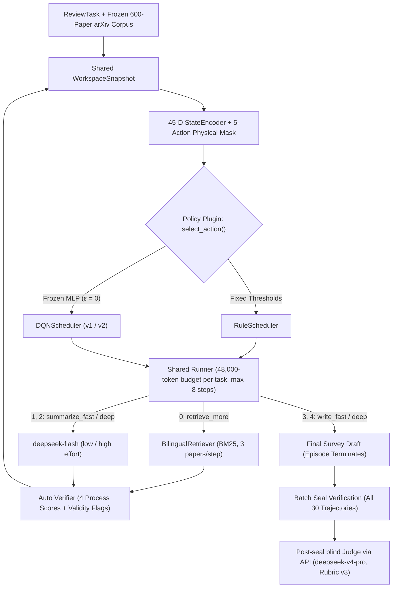
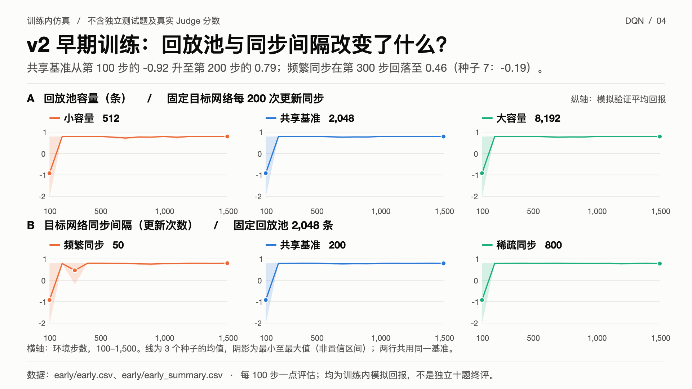

# Multi-Agent Literature Review System with DQN Scheduling

**English** | [简体中文](README_zh.md)

> **Tongji University · Advanced Machine Learning Course Project**
>
> A controlled empirical study of **Deep Q-Network (DQN) dynamic action scheduling** versus **state-aware fixed-rule scheduling (`Rule`)** in a multi-agent literature review workflow. Under the exact same frozen 600-paper arXiv abstract corpus (`arxiv600-review40-v1`), bilingual BM25 retriever, shared execution `Runner`, workflow LLM (`deepseek-flash`), and per-task budget of **48,000 workflow tokens**, only the scheduler's `select_action(state, action_mask)` policy changes across the three evaluated systems (`Rule`, `DQN-v1`, `DQN-v2`). Decision-time states (`45` dimensions) contain only observable process signals; the independent `FinalJudge` (`deepseek-v4-pro`) never participates in runtime routing and evaluates manuscripts blindly only after the entire test batch is cryptographically sealed.

---

## 1. Headline Results on 10 Independent Held-Out Test Tasks

Each of the **10 frozen public test tasks (`T001`–`T010`)** was executed **once per policy** (`30` real workflow trajectories total, exploration `ε = 0`, request cache disabled). Only after all `30/30` runs completed and were sealed did the frozen `v3` `FinalJudge` (`deepseek-v4-pro`) score each manuscript once under a blind protocol.

| Frozen Policy | Overall Judge Score | Coverage | Factuality | Citation Support | Consistency | Workflow Tokens / Task | Mean Steps | Delivered |
|---|---:|---:|---:|---:|---:|---:|---:|---:|
| **Rule** | **0.843** | **0.670** | **0.920** | **0.850** | **0.930** | 19,011.6 | 4.2 | 10/10 |
| **DQN-v1** | 0.771 | 0.510 | 0.885 | 0.770 | 0.920 | 11,140.5 | 3.0 | 10/10 |
| **DQN-v2** | 0.766 | 0.455 | 0.890 | 0.800 | 0.915 | **5,770.5** | **2.1** | 10/10 |

> **Core Takeaway — Quality vs. Cost Trade-off, Not Universal Dominance:**
> - **`Rule` answers more completely; `DQN-v2` reduces mean workflow tokens by 69.6%** (`−13,241.1` tokens/task vs. `Rule`), trading **`−0.077` in overall score** and **`−0.215` in topic coverage** while still delivering `10/10` valid manuscripts.
> - **Observed `DQN-v2` policy:** On all 10 tasks, `DQN-v2` wrote directly after the first retrieval, without another retrieval or a summary. This shortened its paths on these tasks; it does not show that the policy can identify when more evidence is needed.

### 1.1 Pairwise Comparison & Behavioral Breakdown

- **Head-to-head overall score (`10` paired tasks):**
  - `Rule` vs. `DQN-v1`: **6 wins · 3 ties · 1 loss** (`mean Δ = +0.072`)
  - `Rule` vs. `DQN-v2`: **8 wins · 1 tie · 1 loss** (`mean Δ = +0.077`)
  - `DQN-v1` vs. `DQN-v2`: **4 wins · 2 ties · 4 losses** (`mean Δ = +0.005`)
- **Where the quality gap originates:** Coverage is the subscore with the largest gap between `Rule` and `DQN-v2` (`0.670` vs. `0.455`). Three multi-aspect tasks—`T003` (`0.90` vs. `0.20`), `T005` (`0.85` vs. `0.20`), and `T006` (`0.85` vs. `0.20`)—contribute `2.00` out of the `2.15` total coverage difference across the 10 tasks. Conversely, on `T002`, `DQN-v2` (`retrieve_more > write_deep`) scored **0.93** using `6,139` tokens versus `Rule`'s **0.89** at `12,102` tokens. The short path was cheaper and scored higher on this task; the comparison does not establish why.
- **Action load distribution:**
  - `Rule` (`42` steps): `15` `retrieve_more`, `17` `summarize_fast` (consuming `113,237` tokens—**59.6%** of `Rule`'s total cost, including automatic verification and repairs), and `10` `write_fast`.
  - `DQN-v1` (`30` steps): `10` `retrieve_more` (once per task), summarization on `9` tasks (`2` `summarize_fast`, `8` `summarize_deep`), direct writing on `1` task (`T010`), and `10` `write_fast`.
  - `DQN-v2` (`21` steps): `10` `retrieve_more`, `0` summaries, `8` `write_fast`, and `3` `write_deep`. On `T005`, both the initial response and the repair in the first `write_fast` action failed output validation. The next `write_fast` action succeeded. This was the only task where v2 used more tokens than Rule (`11,699` vs. `9,279`).





### 1.2 Cost-Weight Sensitivity (`U_λ`)

Evaluating the **same 30 sealed manuscripts** post hoc under `Utility(λ) = Overall Score − λ × (Workflow Tokens / 48,000)` across four preset cost weights (`Judge` tokens excluded):

| Cost Weight `λ` | Rule | DQN-v1 | DQN-v2 | `DQN-v2` vs. `Rule` (W / T / L) |
|---:|---:|---:|---:|---:|
| **0** | **0.843** | 0.771 | 0.766 | 1 / 1 / 8 |
| **0.25** | **0.744** | 0.713 | 0.736 | 5 / 0 / 5 |
| **0.5** | 0.645 | 0.655 | **0.706** | 8 / 0 / 2 |
| **1** | 0.447 | 0.539 | **0.646** | 9 / 0 / 1 |

At low cost sensitivity (`λ = 0` and `λ = 0.25`), `Rule` achieves the highest mean utility (splitting `5–5` head-to-head with `DQN-v2` at `λ = 0.25`). Under heavier token penalties (`λ = 0.5` and `λ = 1`), `DQN-v2` leads due to its `69.6%` token reduction rather than a reversal in manuscript quality.



### 1.3 Billing Ledger & Operational Mismatch Audit

- **Workflow API ledger (`deepseek-flash`):** `123` dispatched calls (`60` Rule, `41` v1, `22` v2), **359,226** total workflow tokens (`194,513` prompt + `164,713` completion), including `7` output-repair calls and `12` call events recorded as non-OK (this includes output-validation failures, not just API errors) (`5` failed action steps, `0` failed episodes, `0` unknown-usage calls).
- **Independent Judge ledger (`deepseek-v4-pro`):** `30` blind evaluation calls, `30/30` valid labels, **98,487** tokens (`90,048` prompt + `8,439` completion), tracked separately from workflow budget.

| Policy | Dispatched Calls (`W`) | Repair Calls | Error Calls | Failed Steps | Confirmed Mismatch / Known Steps | Unknown Steps | Premature-Write Risk Flags |
|---|---:|---:|---:|---:|---:|---:|---:|
| **Rule** | 60 | 4 | 7 | 3 | 12 / 37 | 5 | 9 |
| **DQN-v1** | 41 | 2 | 3 | 1 | 10 / 28 | 2 | 9 |
| **DQN-v2** | 22 | 1 | 2 | 1 | 10 / 20 | 1 | 10 |

*Note:* Operational mismatch labels (`mismatch-v1` in [`evaluation/mismatch.py`](evaluation/mismatch.py)) are deterministic process diagnostics deduplicated per step. `premature_write` flags writes triggered while ample budget/steps remain and fresh `Verifier` process scores sit below `0.75`; it is a **process-risk proxy**, not counterfactual proof that taking another step would improve final Judge quality.

**Primary Result Artifacts:**
- **Narrative Report:** [Independent 10-Task Final Evaluation (`独立十题终评.md`)](results/final/独立十题终评.md)
- **Structured Tables:** [`overview.csv`](results/final/report/overview.csv) · [`task_wide.csv`](results/final/report/task_wide.csv) · [`per_task.csv`](results/final/report/per_task.csv) · [`pairwise.csv`](results/final/report/pairwise.csv) · [`utility_summary.csv`](results/final/report/utility_summary.csv) · [`actions.csv`](results/final/report/actions.csv) · [`judge_summary.csv`](results/final/report/judge_summary.csv) · [`figures/sources.csv`](results/final/figures/sources.csv)

---

## 2. System Architecture & Controlled Experimental Design



### 2.1 Five Frozen Actions & Shared Verifier

All schedulers interact with the environment exclusively through the five action indices defined in [`core/schema.py`](core/schema.py) and [architecture and interfaces (中文)](docs/architecture.md):

| Action Index | `action_id` | Operational Semantics | Execution Configuration |
|---:|---|---|---|
| `0` | `retrieve_more` | Initial or supplemental bilingual retrieval (`3` new papers/step; invalidates stale summary) | Local `BilingualRetriever` (`bilingual_bm25_v1`) + auto `Verifier` |
| `1` | `summarize_fast` | Lightweight structured synthesis or revision across selected abstracts | `deepseek-flash` (`thinking=enabled`, `reasoning_effort=low`) + auto `Verifier` |
| `2` | `summarize_deep` | Deep structured synthesis or revision across selected abstracts | `deepseek-flash` (`thinking=enabled`, `reasoning_effort=high`) + auto `Verifier` |
| `3` | `write_fast` | Lightweight final survey generation; terminates episode upon valid output | `deepseek-flash` (`thinking=enabled`, `reasoning_effort=low`), no post-Verifier |
| `4` | `write_deep` | Deep final survey generation; terminates episode upon valid output | `deepseek-flash` (`thinking=enabled`, `reasoning_effort=high`), no post-Verifier |

- **Automatic `Verifier` (not a separate action):** Triggered automatically inside `Runner` after every successful `retrieve_more` or `summarize_*`. Produces four `[0, 1]` process scores—`coverage`, `factuality`, `citation_support`, and `consistency`—tracked alongside `valid_scores` and `checked_material_revision`. Before a summary exists, only `coverage` is valid; placeholder zeros are never treated as real low scores or subtracted to form `ΔV`.
- **Physical `Action Mask`:** Blocks only technically impossible actions (e.g., drafting or summarizing when `retrieved_paper_count == 0`, or retrieving when unretrieved papers are exhausted). Suboptimal choices remain unmasked so policies are genuinely tested.

### 2.2 45-Dimensional State Space & Zero-Dependency Inference

- **`StateEncoder` ([`rl/state_encoder.py`](rl/state_encoder.py)):** Maps `WorkspaceSnapshot` and `action_mask` into an identical `45`-float vector for both live `Runner` execution and calibrated simulation:
  - **Task & Progress (`10` dims):** difficulty one-hot (`3`), scaled paper count (`1`), `can_retrieve_more` (`1`), `summary_available` (`1`), `step_fraction` (`1`), `tokens_known` (`1`), used & remaining budget fractions (`2`).
  - **Process Verifier (`10` dims):** `verifier_fresh` & `verifier_stale` flags (`2`), four process scores (`4`), and four dimension-validity flags (`4`).
  - **Intra-Episode Action History (`5 × 5 = 25` dims):** per action `call_fraction` (action count divided by the maximum episode length), `last_delta`, `delta_valid`, `low_gain_fraction`, and `token_share`.
- **Training vs. Inference Separation:** Training uses CPU **Masked Double-DQN** (`45 → 64 → 64 → 5` ReLU MLP, Smooth L1 loss, gradient clipping) in [`rl/dqn.py`](rl/dqn.py). Frozen checkpoints are exported as deterministic JSON (`dense-relu-v1`) and loaded at inference time by [`rl/scheduler.py`](rl/scheduler.py) using **only the Python standard library**—requiring neither PyTorch nor training code during evaluation.

### 2.3 Strict Anti-Leakage & Integrity Guarantees

1. **Prompt & Label Isolation:** `ReviewTask.from_dict` whitelists public fields only; `BilingualRetriever` never accesses task IDs, curation seeds, or reference evidence; `Runner` rejects `pilot_only` corpora on formal splits.
2. **Checkpoint Provenance Binding:** [`experiments/final/run_final.py`](experiments/final/run_final.py) verifies checkpoint raw SHA-256 digests, `experiment_sha256`, `retrieval_spec_sha256`, `RunnerConfig` equality, and zero overlap between `development_review_ids` and `test_tasks.json` before execution.
3. **Whole-Batch Sealing Before Blind Evaluation:** [`evaluation/_sealed.py`](evaluation/_sealed.py) and [`evaluation/judge.py`](evaluation/judge.py) verify that all `30` trajectories finished and were hashed before constructing policy-blind Judge payloads (`survey_instruction`, `final_text`, `body_citations`, `bibliography`).
4. **Budget accounting:** The Runner checks the remaining budget before each call and records actual usage afterward, so the last call can take the total above `48,000` workflow tokens. The episode ends with `token_budget` when cumulative usage reaches or exceeds the budget, or `usage_unknown` when usage is missing. In either case, no candidate draft from that step is published or sent to the Judge.

---

## 3. Calibrated Simulation & Controlled Ablations

> **Scope Warning:** All curves and tables in [`results/ablation/`](results/ablation/) and [`results/final/early/`](results/final/early/) come from **in-training calibrated simulation**, **not** independent held-out LLM test runs. Simulated terminal quality (`estimated_final_quality`) is a calibrated proxy, never reported as a real `judge_score`.

- **Empirical Calibration Generations ([`rl/calibration.py`](rl/calibration.py), [`rl/synthetic_env.py`](rl/synthetic_env.py)):**
  - **`v1`** ([`checkpoints/v1/`](checkpoints/v1/), [`results/ablation/v1/`](results/ablation/v1/)): calibrated on `7` training tasks (`24` real episodes, `44` joint state-action bins, `2` holdout training tasks).
  - **`v2`** ([`checkpoints/v2/`](checkpoints/v2/), [`results/ablation/v2/`](results/ablation/v2/)): expanded to `25` training tasks (`60` real episodes, `69` joint bins, `5` holdout training tasks), fitting a review-balanced coverage ridge + stage/writer residual terminal quality proxy (holdout MAE `0.040` vs. train-mean baseline `0.051`).
- **Two Single-Factor Ablations (`5 configs × 3 seeds {7, 17, 27}`, `20,000` steps each, all seeds retained):**
  1. **Replay Buffer Capacity** (at `target_interval = 200`): `512` (`buffer_small`), `2,048` (`base`), `8,192` (`buffer_large`). In v2, the `2,048` and `8,192` buffers did not fill in the first `1,500` steps and had identical checkpoint returns for each seed. The `512` buffer started overwriting at step `513`; its first observed difference from `2,048` was at step `600` (seeds 7 and 17) or `700` (seed 27).
  2. **Target-Network Sync Interval** (at `capacity = 2,048`): `50` (`target_frequent`), `200` (`base`), `800` (`target_rare`) gradient updates. In v2, the validation return for `target_frequent`, seed 7, fell to `−0.195` at step `300`. It first recorded three consecutive returns `≥ 0.50` at step `600`; the other 14 runs did so at step `300` or `400`. All stayed above the threshold through step `1,500`; this is an early-window result, not a convergence criterion for the full run.



**Ablation & Diagnostic Archives:**
- [v1 Full 20,000-Step Ablations](results/ablation/v1/) · [v2 Full 20,000-Step Ablations](results/ablation/v2/) · [v2 Early Climb Notes (`100–1,500` steps)](results/final/archive/v2早期爬升解读.md)
- [Reward Sensitivity & Limitations Analysis](results/final/archive/奖励敏感性与局限性分析.md) (explains why alternative reward penalties shifted simulated paths across individual seeds without yielding a reliably adaptive re-retrieval policy)

---

## 4. Offline Verification (No API Key or Network Required)

Run all verification commands from the repository root using **Python 3.12** (CPU).
- **Do NOT configure `.env` and do NOT pass `--dispatch` during verification** (`--dispatch` initiates live paid DeepSeek API requests).
- Data validation, `run_final --check`, and SVG figure generation need only the Python standard library. The full offline test suite also requires `torch==2.15.0` from [`requirements-rl.txt`](requirements-rl.txt); without it, the DQN training and ablation test modules are skipped.

```bash
# 1. (Optional) Verify PyTorch if running training/ablation regression tests
python -c "import torch; print(torch.__version__)"

# 2. Run the full offline unit & contract test suite
python -m unittest discover -s tests -p 'test_*.py' -v

# 3. Verify SHA-256 integrity of the frozen 600-paper corpus, shards, and 40 tasks
python -m utils.data_release

# 4. Verify the public task/corpus manifest and load both frozen DQN policies (no episodes or Judge calls)
python -m experiments.final.run_final --check

# 5. Regenerate all 4 publication figures from public CSVs into a fresh directory
python -m experiments.final.plot_final --out-dir outputs/redraw-001
```

- **Cross-platform plotting note:** `plot_final` writes editable SVGs directly and uses macOS `sips` to rasterize `1920×1080` PNGs. On Linux/Windows (without `sips`), append `--svg-only` to generate SVGs cleanly, or inspect the pre-rendered PNGs under [`results/final/figures/`](results/final/figures/). Always pass a **new** `--out-dir` path inside `outputs/` when re-plotting (existing directories are never overwritten).
- **Optional synthetic training pipeline rehearsal (requires PyTorch):**
  ```bash
  python -m experiments.ablate --size smoke --fixture-calibration --config base --seeds 7 --output outputs/smoke-001
  ```
  Exercises the `collect → calibrate → train` code path on synthetic fixtures without API calls (does not produce real literature-review quality findings).
- **Additional checks:** `python -m doctest docs/architecture.md` runs the architecture guide’s offline scheduler example.

### Reproducibility Boundaries

- **What public artifacts reproduce offline:** Exact summary means, head-to-head counts, utility sensitivity tables, publication SVG/PNG figures, frozen policy instantiation, checkpoint-to-manifest cryptographic bindings, and all offline unit/integration regressions.
- **What is intentionally excluded:** API keys, full raw training LLM payloads, per-manuscript Judge HTTP receipts, and sealed private test reference evidence (`.local-data/sealed/`). Public CSVs support recalculation and plotting, not reconstruction of individual drafts or verification of original Judge receipts. Recomputing the report from the sealed batch requires the original trajectories and receipts; retraining the published checkpoints also requires the original labeled training bundle.
- **Future runs on `T001`–`T010`:** Because results on the 10 test tasks are now public, any subsequent execution on `data/test_tasks.json` must be reported as a **re-test / replication**, not fresh held-out evidence.

---

## 5. Repository Structure

| Path | Description |
|---|---|
| [`core/`](core/), [`agents/`](agents/), [`litreview/`](litreview/) | Shared 5-action `Runner`, `RuleScheduler`, `BilingualRetriever` (`bilingual_bm25_v1`), `Verifier`, and DeepSeek HTTP client (legacy 4-role demo in `litreview/pipeline.py` is not the formal baseline) |
| [`rl/`](rl/), [`experiments/`](experiments/) | `45`-D `StateEncoder`, CPU Masked Double-DQN, empirical calibration, synthetic Gym environment, and ablation runners |
| [`experiments/final/`](experiments/final/) | Formal 3-policy execution (`run_final.py`), post-seal blind evaluation via the paid Judge API (`judge_final.py`), statistical aggregation (`report_final.py`), and figure renderer (`plot_final.py`) |
| [`checkpoints/`](checkpoints/) | Frozen `policy.json` weights and `experiment.json` calibration/training metadata for `v1` and `v2` (no intermediate checkpoints) |
| [`evaluation/`](evaluation/) | Blind `FinalJudge` `v3` rubric & receipt verification (`judge.py`), batch seal checker (`_sealed.py`), and `mismatch-v1` step classifier (`mismatch.py`) |
| [`results/`](results/) | [`final/`](results/final/): independent 10-task final report, CSVs, and figures (`early/` & Fig. 04 are in-training simulation); [`ablation/`](results/ablation/): `v1` and `v2` simulation ablations |
| [`data/`](data/), [`curation/`](curation/), [`utils/data_release.py`](utils/data_release.py) | Frozen snapshot `arxiv600-review40-v1`, public train/test tasks, curation audit report ([`curation/REPORT.md`](curation/REPORT.md)), and offline hash validator |
| [`tests/`](tests/) | Offline regression tests. Retrieval and checkpoint binding are tested using synthetic inputs, without live calls or archived model responses. |
| [architecture and interfaces (中文)](docs/architecture.md) | Shared action, state, and evaluation contracts. See the [retriever](agents/retrieval.py) for bilingual retrieval and the [Judge](evaluation/judge.py) for the final scoring rubric. |

---

## 6. Dataset Provenance & Usage Boundaries

- **Frozen Snapshot (`arxiv600-review40-v1`):** Contains **600 historical versioned arXiv abstracts** (`data/arxiv_corpus.json`) and **40 curated Chinese survey tasks** (`30` training tasks in `data/train_tasks.json`, `10` independent test tasks in `data/test_tasks.json`).
- **Attribution & Licensing:** Each corpus entry preserves authors, versioned arXiv ID, and official URLs. Paper abstracts originate from their respective authors and arXiv records—not original works of this project—and this repository grants no separate license over third-party abstracts. Retain attribution and verify individual paper licenses before redistribution.
- **Artifact Scope:**
  - `data/corpus_chunk/` holds 6 verification shards (`100` entries each) of the exact same `600`-paper corpus, not additional papers.
  - `data/test_tasks.json` contains public survey instructions only; private test curation references are not distributed.
  - `data/samples/` (`purpose=pilot_only`) and `examples/` contain pilot or synthetic fixtures strictly for integration testing and cannot be used as formal experimental data. See [`data/README.md`](data/README.md) for full details.
