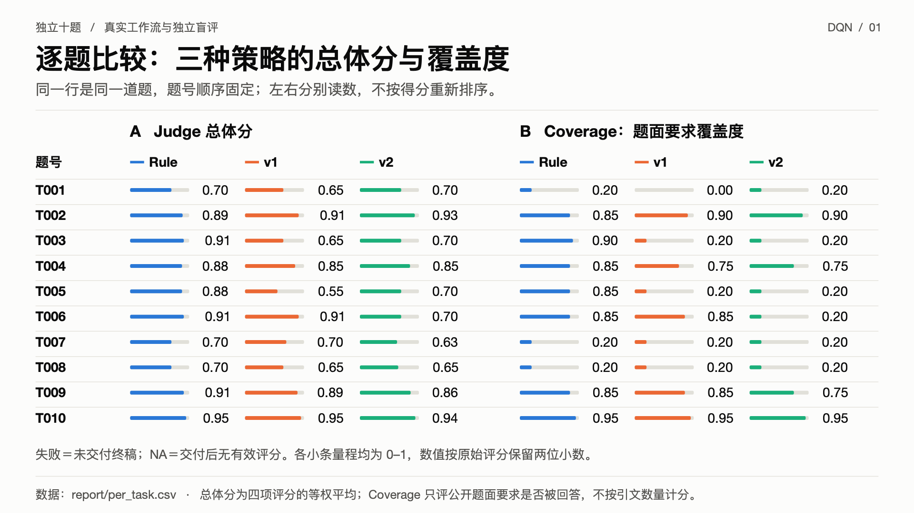
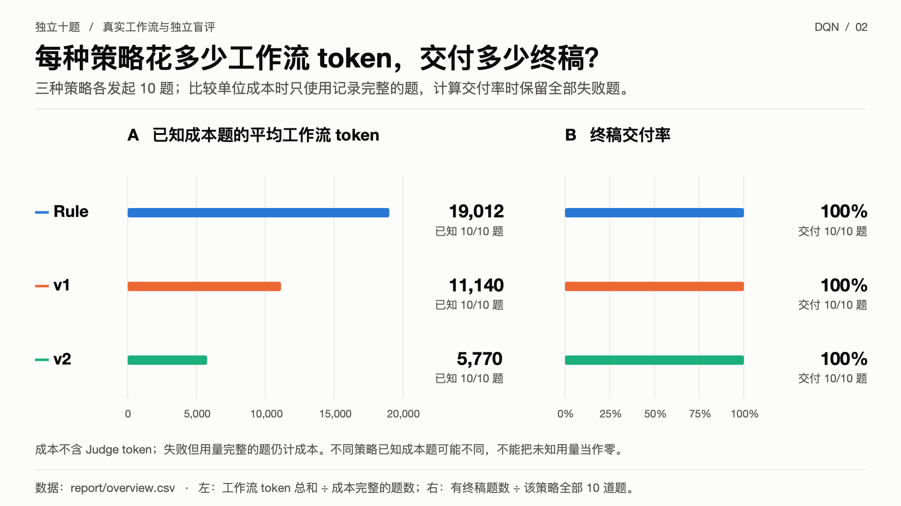
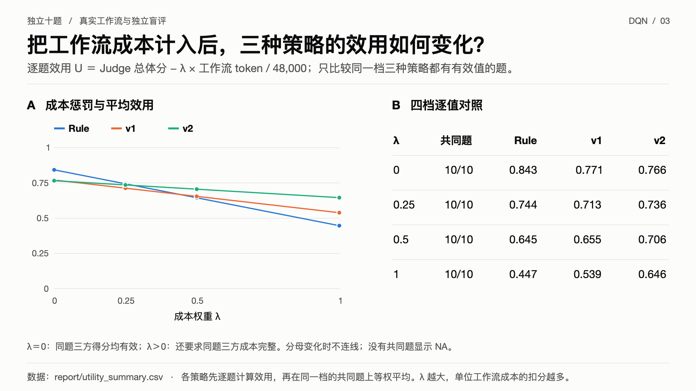
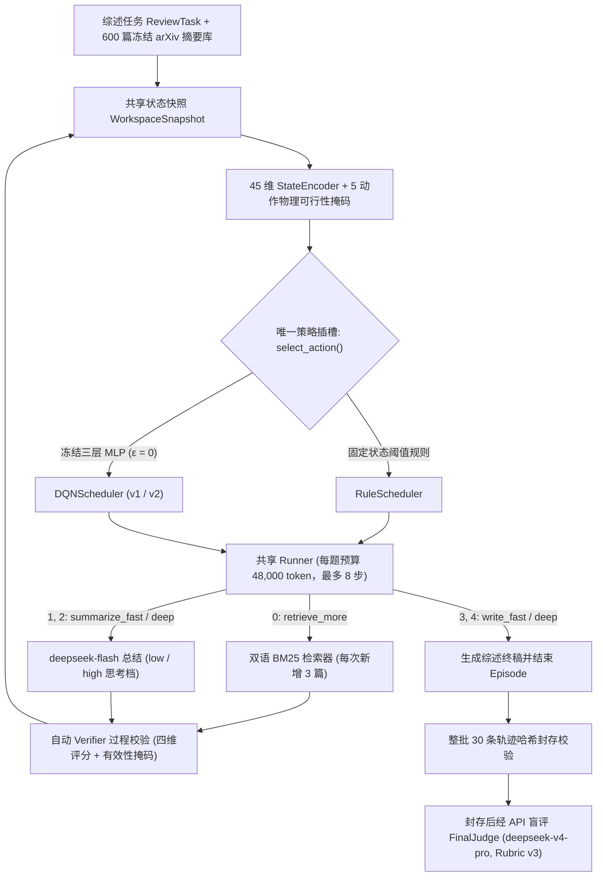
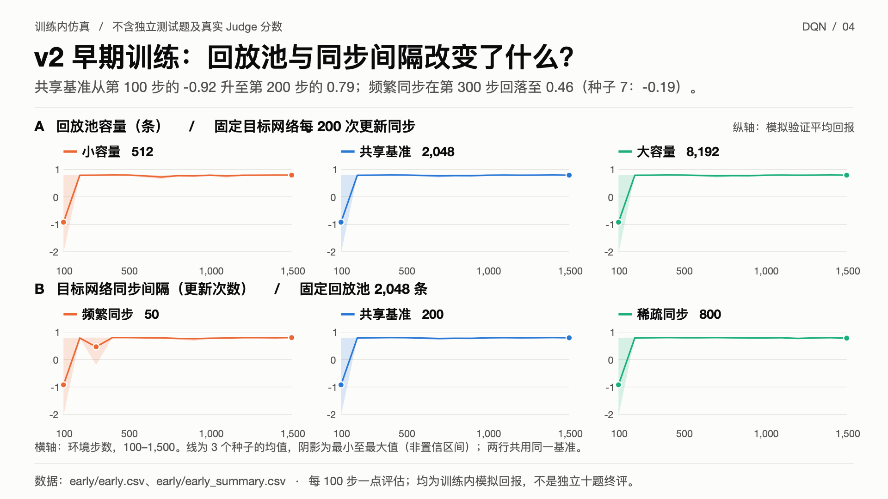

# 基于 DQN 调度的多智能体文献综述系统

[English](README.md) | **简体中文**

> **同济大学《高级机器学习》课程项目**
>
> 本仓库在严格受控条件下对比**固定规则调度器（`Rule`）**与两个**冻结权重的 Masked Double-DQN 调度器（`DQN-v1`、`DQN-v2`）**在多智能体文献综述工作流中的表现。三者共用同一份 600 篇冻结 arXiv 摘要库（`arxiv600-review40-v1`）、中英双语 BM25 检索器、统一执行器 `Runner`、工作流大模型（`deepseek-flash`）以及每题 **48,000 工作流 token** 预算，仅替换策略层的 `select_action(state, action_mask)`。DQN 的 `45` 维输入状态仅编码决策时刻可见的过程信号；独立终稿评审 `FinalJudge`（`deepseek-v4-pro`）不参与运行时调度，仅在全部测试轨迹封存后，通过付费 API 对终稿盲评。

---

## 1. 独立十题终评核心结论

在 **10 道冻结公开测试题（`T001`–`T010`）** 上，每个“题目 × 策略”组合仅真实运行一次（共 `30` 条工作流轨迹，关闭探索 `ε = 0`，禁用缓存）。待全部 `30/30` 条轨迹完成并校验封存后，使用冻结 `v3` 口径的独立 `FinalJudge`（`deepseek-v4-pro`）对每份终稿盲评一次。

| 冻结策略 | 终稿总分 | 终稿覆盖度 | 事实性 | 引用支持 | 一致性 | 工作流 token / 题 | 平均步数 | 成稿率 |
|---|---:|---:|---:|---:|---:|---:|---:|---:|
| **Rule** | **0.843** | **0.670** | **0.920** | **0.850** | **0.930** | 19,011.6 | 4.2 | 10/10 |
| **DQN-v1** | 0.771 | 0.510 | 0.885 | 0.770 | 0.920 | 11,140.5 | 3.0 | 10/10 |
| **DQN-v2** | 0.766 | 0.455 | 0.890 | 0.800 | 0.915 | **5,770.5** | **2.1** | 10/10 |

> **核心结论——质量与成本的显式权衡，而非“DQN 全面优于规则”：**
> - **`Rule` 答得更完整；`DQN-v2` 平均每题节省 69.6% 的工作流 token**（较 `Rule` 少用 `13,241.1` token/题），在保持 `10/10` 终稿交付的同时，终稿总分低 **0.077**、题面覆盖度低 **0.215**。
> - **`DQN-v2` 的实际选择：** 在全部 10 道测试题上，`DQN-v2` 均在首检后直接写稿，没有补检索或总结。这缩短了这批题上的执行路径，但不能说明策略能判断哪些题需要补充证据。

### 1.1 逐题配对表现与路径拆解

- **逐题总分胜平负（`10` 题配对）：**
  - `Rule` 对 `DQN-v1`：**6 胜 · 3 平 · 1 负**（平均差 `+0.072`）
  - `Rule` 对 `DQN-v2`：**8 胜 · 1 平 · 1 负**（平均差 `+0.077`）
  - `DQN-v1` 对 `DQN-v2`：**4 胜 · 2 平 · 4 负**（平均差 `+0.005`）
- **质量差距的主要来源：** `Rule` 与 `DQN-v2` 差距最大的分项是**终稿覆盖度**（`0.670` 对 `0.455`），其中 `T003`（`0.90` 对 `0.20`）、`T005`（`0.85` 对 `0.20`）、`T006`（`0.85` 对 `0.20`）三题合计贡献了 `2.00 / 2.15` 的覆盖度净差。反例 `T002` 上，`DQN-v2`（`retrieve_more > write_deep`）仅用 `6,139` token 取得 **0.93** 分，高于 `Rule` 用 `12,102` token 取得的 **0.89** 分。这道题的短路径更省、得分也更高，但不能据此认定原因是首检材料充足。
- **五动作实际负载：**
  - `Rule`（共 `42` 步）：检索 `15` 次、`summarize_fast` `17` 次（连同自动 Verifier 校验与输出修复共消耗 `113,237` token，占 `Rule` 总成本的 **59.6%**）、`write_fast` `10` 次。
  - `DQN-v1`（共 `30` 步）：每题仅首检 `1` 次；`9` 题经过总结（`2` 次 `summarize_fast`、`8` 次 `summarize_deep`），`1` 题直写（`T010`），终稿均为 `write_fast`。
  - `DQN-v2`（共 `21` 步）：每题首检 `1` 次后直接写稿（`0` 次总结、`8` 次 `write_fast`、`3` 次 `write_deep`）。`T005` 的第一个 `write_fast` 动作中，初次响应及一次修复均未通过输出校验；第二个 `write_fast` 动作成功。这是 v2 唯一比 Rule 更费 token 的题（`11,699` 对 `9,279`）。





### 1.2 成本权重敏感性分析（`U_λ`）

在不重新训练、不筛选权重的前提下，对**同一批 30 份封存终稿**事后计算逐题效用 `U_λ = 终稿总分 − λ × (工作流 token / 48,000)`（独立 Judge 用量不计入扣分）：

| 成本权重 `λ` | Rule | DQN-v1 | DQN-v2 | `DQN-v2` 对 `Rule` 逐题胜 / 平 / 负 |
|---:|---:|---:|---:|---:|
| **0** | **0.843** | 0.771 | 0.766 | 1 / 1 / 8 |
| **0.25** | **0.744** | 0.713 | 0.736 | 5 / 0 / 5 |
| **0.5** | 0.645 | 0.655 | **0.706** | 8 / 0 / 2 |
| **1** | 0.447 | 0.539 | **0.646** | 9 / 0 / 1 |

在重视成稿质量的 `λ = 0`、`0.25` 两档，`Rule` 平均效用最高（`λ = 0.25` 时与 `DQN-v2` 逐题各胜 5 题）；当工作流成本惩罚加重至 `λ = 0.5`、`1` 时，`DQN-v2` 因工作流 token 用量更低而取得最高平均效用。



### 1.3 真实调用账本与过程错配统计

- **工作流调用账本（`deepseek-flash`）：** 实发 **123** 次请求（`Rule` 60、`v1` 41、`v2` 22），输入 `194,513` + 输出 `164,713` = **359,226** 工作流 token（含 `7` 次格式修复请求、`12` 条状态非 `ok` 的调用记录（含输出校验失败，不等同于网络错误）、`5` 个失败动作步；终局失败 `0` 题，未知用量 `0` 次）。
- **独立 Judge 账本（`deepseek-v4-pro`）：** 实发 **30** 次盲评请求，有效评分 `30/30`，输入 `90,048` + 输出 `8,439` = **98,487** token，独立记账且不计入工作流预算。

| 策略 | 工作流实发请求 (`W`) | 修复请求 | 错误调用 | 失败动作步 | 确认错配步 / 可判步 | 不可判步 | 过早写风险步 |
|---|---:|---:|---:|---:|---:|---:|---:|
| **Rule** | 60 | 4 | 7 | 3 | 12 / 37 | 5 | 9 |
| **DQN-v1** | 41 | 2 | 3 | 1 | 10 / 28 | 2 | 9 |
| **DQN-v2** | 22 | 1 | 2 | 1 | 10 / 20 | 1 | 10 |

*口径说明：* 过程错配（[`evaluation/mismatch.py`](evaluation/mismatch.py) 中的 `mismatch-v1`）按步骤去重统计；不可判步不等于无错配。“过早写（`premature_write`）”指剩余预算与步数充裕但新鲜过程 `Verifier` 指标未达 `0.75` 时直接写稿，属于**过程风险代理指标**，不等同于反事实意义上的终稿差评。

**终评完整材料索引：**
- **终评主报告：** [独立十题终评 (`results/final/独立十题终评.md`)](results/final/独立十题终评.md)
- **公开统计表：** [总览 `overview.csv`](results/final/report/overview.csv) · [逐题三策略横表 `task_wide.csv`](results/final/report/task_wide.csv) · [逐轨迹明细 `per_task.csv`](results/final/report/per_task.csv) · [配对胜平负 `pairwise.csv`](results/final/report/pairwise.csv) · [四档效用 `utility_summary.csv`](results/final/report/utility_summary.csv) · [动作负载 `actions.csv`](results/final/report/actions.csv) · [独立 Judge 账 `judge_summary.csv`](results/final/report/judge_summary.csv) · [图表数据来源 `figures/sources.csv`](results/final/figures/sources.csv)

---

## 2. 系统架构与受控实验设计



### 2.1 五个冻结动作与自动 Verifier

所有策略通过 [`core/schema.py`](core/schema.py) 与 [技术架构与接口](docs/architecture.md) 约定的五个固定动作与环境交互：

| 动作编号 | `action_id` | 功能语义 | 执行配置与后置校验 |
|---:|---|---|---|
| `0` | `retrieve_more` | 首次或补充检索（每次取 `3` 篇未选论文；补检会使旧总结失效） | 本地双语 `BilingualRetriever`（`bilingual_bm25_v1`）+ 自动调用 `Verifier` |
| `1` | `summarize_fast` | 对已检索论文做轻量结构化总结或修订 | `deepseek-flash`（`thinking=enabled`, `reasoning_effort=low`）+ 自动调用 `Verifier` |
| `2` | `summarize_deep` | 对已检索论文做深度结构化总结或修订 | `deepseek-flash`（`thinking=enabled`, `reasoning_effort=high`）+ 自动调用 `Verifier` |
| `3` | `write_fast` | 轻量撰写终稿；有效成稿后立即终止当前轨迹 | `deepseek-flash`（`thinking=enabled`, `reasoning_effort=low`），无后置 `Verifier` |
| `4` | `write_deep` | 深度撰写终稿；有效成稿后立即终止当前轨迹 | `deepseek-flash`（`thinking=enabled`, `reasoning_effort=high`），无后置 `Verifier` |

- **共享自动 `Verifier`（非独立调度动作）：** 在 `retrieve_more` 或 `summarize_*` 成功后由 `Runner` 按统一规则自动触发，输出 `coverage`、`factuality`、`citation_support`、`consistency` 四项 `[0, 1]` 过程分，并记录 `valid_scores` 与 `checked_material_revision`。尚无总结时仅 `coverage` 有效，其余占位 `0.0` 绝不充当真实差评或参与跨维度的 `ΔV` 相减。
- **物理 `Action Mask`：** 仅屏蔽物理上不可执行的动作（如未检索任何论文时禁止总结与写稿、无剩余候选论文时禁止补检），不人为屏蔽低收益或次优动作。

### 2.2 45 维状态编码与零依赖冻结推理

- **`StateEncoder`（[`rl/state_encoder.py`](rl/state_encoder.py)）：** 真实 `Runner` 与标定仿真环境共用同一编码器，将动作前 `WorkspaceSnapshot` 与 `action_mask` 映射为 `45` 维浮点向量：
  - **任务与预算进度（`10` 维）：** 难度独热编码（`3`）、归一化论文数（`1`）、可补检标记（`1`）、总结存在标记（`1`）、步数比例（`1`）、用量已知标记（`1`）、已用与剩余预算比例（`2`）。
  - **Verifier 过程信号（`10` 维）：** 新鲜/过期标记（`2`）、四维过程评分（`4`）及对应有效性掩码（`4`）。
  - **任务内五动作动态历史（`5 × 5 = 25` 维）：** 每个动作的执行次数除以最大步数 `call_fraction`、最近可比增量 `last_delta`、增量有效标记 `delta_valid`、连续低收益/失败占比 `low_gain_fraction` 与累计 token 占比 `token_share`。
- **训练与推理解耦：** 训练侧使用 [`rl/dqn.py`](rl/dqn.py) 的 CPU **Masked Double-DQN**（`45 → 64 → 64 → 5` ReLU MLP，Smooth L1 损失与梯度裁剪）；导出的冻结权重 `policy.json`（`dense-relu-v1`）由 [`rl/scheduler.py`](rl/scheduler.py) **仅用 Python 标准库**加载推理，评测阶段无需依赖 PyTorch 训练框架。

### 2.3 防泄漏与评测隔离机制

1. **题面与私有证据隔离：** `ReviewTask.from_dict` 仅白名单放行公开字段；`BilingualRetriever` 不读取题目 ID、出题种子或评分要点；`Runner` 严禁将 `pilot_only` 联调样例用于正式切分。
2. **权重与环境哈希绑定：** [`experiments/final/run_final.py`](experiments/final/run_final.py) 在运行前强制核验 `policy.json` 原始字节 SHA-256、`experiment_sha256`、`retrieval_spec_sha256`、`RunnerConfig` 一致性，并确认训练开发题目集合与 `test_tasks.json` 零交集。
3. **先整批封存、后盲化评审：** [`evaluation/_sealed.py`](evaluation/_sealed.py) 与 [`evaluation/judge.py`](evaluation/judge.py) 强制要求全部 `30` 条测试轨迹落盘封存后才构造剥离策略身份的盲评请求体。
4. **预算结算：** Runner 在调用前检查剩余预算，调用后按实际用量结算，因此最后一次调用可能使总用量超过 `48,000` token。累计用量达到或超过预算时以 `token_budget` 终止；用量未知时以 `usage_unknown` 终止。两种情况下，当步的候选终稿均不发布，也不送交 Judge。

---

## 3. 标定仿真与超参数消融实验

> **数据性质边界：** [`results/ablation/`](results/ablation/) 与 [`results/final/early/`](results/final/early/) 中的全部曲线和表格均来自**训练内标定仿真**，**不是**独立测试集上的真实 LLM 成绩。仿真终局质量（`estimated_final_quality`）是经训练标签校准的代理估计，不冒充真实 `judge_score`。

- **两代真实采样标定环境（[`rl/calibration.py`](rl/calibration.py)、[`rl/synthetic_env.py`](rl/synthetic_env.py)）：**
  - **`v1`**（[`checkpoints/v1/`](checkpoints/v1/)、[`results/ablation/v1/`](results/ablation/v1/)）：由 `7` 道训练题、`24` 条真实轨迹（`44` 个联合状态-动作分桶）标定，`2` 道训练留出题核验。
  - **`v2`**（[`checkpoints/v2/`](checkpoints/v2/)、[`results/ablation/v2/`](results/ablation/v2/)）：扩展至 `25` 道训练题、`60` 条真实轨迹（`69` 个联合分桶）与 `5` 道训练留出题，使用题目均衡的覆盖度岭回归加阶段/写手残差拟合终局质量代理（留出题 MAE `0.040`，优于训练均值基线的 `0.051`）。
- **两组单因素控制变量消融（每版 `5 配置 × 3 种子 {7, 17, 27}`，训练 `20,000` 步，保留全部种子，不按结果挑图）：**
  1. **Replay Buffer 容量**（固定 `target_interval = 200`）：`512`（`buffer_small`）、`2,048`（共用基准 `base`）、`8,192`（`buffer_large`）。v2 前 `1,500` 步内，`2,048` 与 `8,192` 均未写满，同一种子各检查点回报逐点相同。容量 `512` 从第 `513` 步开始覆盖旧样本；与 `2,048` 首次可见的回报差异在第 `600` 步（种子 7、17）或 `700` 步（种子 27）。
  2. **Target-Net 同步间隔**（固定 `capacity = 2,048`）：每 `50`（`target_frequent`）、`200`（共用基准 `base`）、`800`（`target_rare`）次梯度更新同步一次。v2 频繁同步组（`50`）的种子 7 在第 `300` 步回报跌至 `−0.195`，到第 `600` 步才首次连续三次验证回报 `≥ 0.50`；其余 14 组在第 `300` 或 `400` 步达到该条件。各组过线后至第 `1,500` 步未再跌破阈值，不代表全程已收敛。



**训练与消融归档入口：**
- [v1 完整 20,000 步消融结果](results/ablation/v1/) · [v2 完整 20,000 步消融结果](results/ablation/v2/) · [v2 早期爬升解读（100–1,500 步）](results/final/archive/v2早期爬升解读.md)
- [奖励敏感性与局限性分析](results/final/archive/奖励敏感性与局限性分析.md)（展示调整成本惩罚与低覆盖直写罚项的仿真探测：虽有个别种子出现补检行为，但跨种子不稳定，未替换正式冻结策略）

---

## 4. 无 Key 离线验证与复现指南

在仓库根目录下使用 **Python 3.12**（CPU）即可执行全部离线核验。
- **无需配置 `.env`，请勿传入 `--dispatch`**（`--dispatch` 会向 DeepSeek 官方 API 发起真实计费请求）。
- 数据校验、`run_final --check` 和 SVG 重绘仅需 Python 标准库。运行完整离线测试还需要 [`requirements-rl.txt`](requirements-rl.txt) 中的 `torch==2.15.0`；未安装时，DQN 训练和消融测试模块会跳过。

```bash
# 1.（可选）若需运行训练与消融回归测试，先确认 PyTorch 已安装
python -c "import torch; print(torch.__version__)"

# 2. 运行完整离线单元测试与契约回归套件
python -m unittest discover -s tests -p 'test_*.py' -v

# 3. 校验 600 篇冻结语料、分片与 40 道公开任务的 SHA-256 完整性
python -m utils.data_release

# 4. 运行终评本地预检（核对公开题面、语料和检索指纹，加载两份冻结 DQN；不执行题目或评分）
python -m experiments.final.run_final --check

# 5. 从公开 CSV 重新生成全部 4 组出版级 SVG/PNG 图表（须指定尚不存在的新目录）
python -m experiments.final.plot_final --out-dir outputs/redraw-001
```

- **跨平台作图说明：** `plot_final` 直接输出可编辑 SVG，并在 macOS 上调用系统自带 `sips` 渲染 `1920×1080` PNG；Linux/Windows 环境可在命令末尾加 `--svg-only` 仅生成 SVG，或直接查阅仓库已发布的 [`results/final/figures/`](results/final/figures/)。每次重画请指定 `outputs/` 下尚不存在的新 `--out-dir` 目录名。
- **可选的合成数据“采集 → 标定 → 训练”冒烟演练（需安装 PyTorch）：**
  ```bash
  python -m experiments.ablate --size smoke --fixture-calibration --config base --seeds 7 --output outputs/smoke-001
  ```
  该命令使用合成 fixture 验证完整训练代码链路，不发起网络调用，也不产生新的真实综述质量结论。
- **附加检查：** `python -m doctest docs/architecture.md` 运行架构文档中的离线调度示例。

### 复现边界说明

- **公开仓库可直接复现的内容：** 终评汇总均值、逐题配对胜平负、效用敏感性表、四组出版级图表、冻结策略加载与哈希核验，以及全部离线回归测试。
- **未随公开仓库分发的材料：** API 密钥、完整训练轨迹原始请求负载、逐稿 Judge HTTP 原始回执及私有测试参考证据（`.local-data/sealed/`）。因此仅凭公开 CSV 不能重做盲评打分、逐字还原生成综述原文或从零重标定出完全相同的权重文件；“从原始封存输入重算统计”与“从公开 CSV 重画图表”是两件不同的事。
- **后续复测声明：** 由于这 10 道公开测试题的结果已经披露，今后在 `data/test_tasks.json` 上的再次运行应明确标记为**复测（re-test）**，不再作为新的独立留出测试证据。

---

## 5. 仓库目录导航

| 路径 | 内容说明 |
|---|---|
| [`core/`](core/)、[`agents/`](agents/)、[`litreview/`](litreview/) | 五动作共享 `Runner`、固定规则 `RuleScheduler`、双语检索 `BilingualRetriever`（`bilingual_bm25_v1`）、过程 `Verifier` 与 DeepSeek 官方 API 客户端（`litreview/pipeline.py` 中的旧四角色演示非正式基线） |
| [`rl/`](rl/)、[`experiments/`](experiments/) | `45` 维 `StateEncoder`、CPU Masked Double-DQN、训练标定、合成 Gym 环境及消融实验脚本 |
| [`experiments/final/`](experiments/final/) | 三策略正式执行（`run_final.py`）、封存后通过付费 API 独立盲评（`judge_final.py`）、汇总统计（`report_final.py`）与图表绘制（`plot_final.py`）入口 |
| [`checkpoints/`](checkpoints/) | `v1`、`v2` 各一份正式冻结权重 `policy.json` 及标定/训练元数据 `experiment.json`（不含中间过程 checkpoint） |
| [`evaluation/`](evaluation/) | 独立 `FinalJudge` `v3` 协议与回执核验（`judge.py`）、整批封存检查（`_sealed.py`）与过程错配分类器（`mismatch.py`） |
| [`results/`](results/) | [`final/`](results/final/) 为独立十题终评报告、CSV 与图表（其中 `early/` 与图 `04` 为训练内仿真数据）；[`ablation/`](results/ablation/) 为 `v1`、`v2` 训练内消融记录 |
| [`data/`](data/)、[`curation/`](curation/)、[`utils/data_release.py`](utils/data_release.py) | 冻结数据包 `arxiv600-review40-v1`、公开训练/测试任务、题目审查与切分报告（[`curation/REPORT.md`](curation/REPORT.md)）及离线完整性校验工具 |
| [`tests/`](tests/) | 离线回归测试。检索规格与权重绑定使用合成输入验证，不发起真实调用，也不依赖历史模型响应。 |
| [技术架构与接口](docs/architecture.md) | 跨模块动作、状态和评测契约；双语检索见[检索器实现](agents/retrieval.py)，终稿盲评口径见 [Judge 实现](evaluation/judge.py)。 |

---

## 6. 数据来源、许可与使用边界

- **正式冻结快照（`arxiv600-review40-v1`）：** 包含 **600 篇历史带版本 arXiv 论文摘要**（`data/arxiv_corpus.json`）与 **40 道人工审查构造的综述任务**（`30` 道训练题 `data/train_tasks.json`、`10` 道独立测试题 `data/test_tasks.json`）。
- **署名与许可说明：** 语料保留原作者、带版本的 arXiv ID 与官方原文链接。论文摘要来自对应原论文记录，并非项目组原创，本仓库不对第三方论文摘要另行授予许可；引用或再分发时请保留原始署名与来源，并核对各论文自身许可条款。实验结果仅衡量固定摘要库内的多步调度与综述写作表现，不代表全文检索或最新文献进展。
- **目录与样例边界：**
  - `data/corpus_chunk/` 为同一份 `600` 篇语料的 `6 × 100` 校验分片，不是额外论文。
  - `data/test_tasks.json` 仅含公开题面，私有测试核查证据不随公开仓库发布。
  - `data/samples/`（标记 `purpose=pilot_only`）与 `examples/` 中的虚构或小样本仅用于接口联调与离线回归，不能充当正式实验数据。详见[数据目录说明](data/README.md)。
